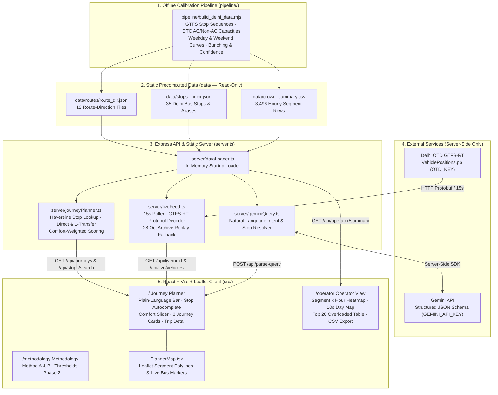
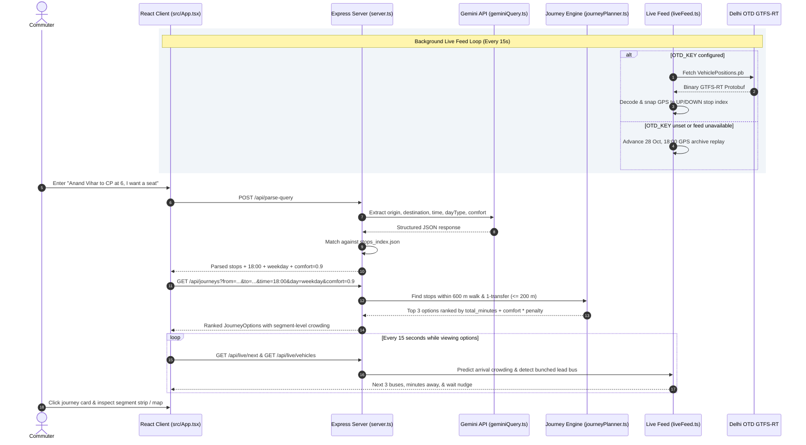

# Bheed — Crowdedness-Aware Bus Journey Planner for Delhi

**Bheed** is a full-stack transit intelligence and journey planning application for Delhi DTC and Cluster buses. It pairs historical October ticket demand profiles with live GTFS-RT bus GPS positions so commuters can trade off travel time against seat comfort, while giving transit operators corridor-level crowding visibility and dispatch sizing.

---

## Table of Contents

- [System Architecture Diagram](#system-architecture-diagram)
- [End-to-End Flow Diagram](#end-to-end-flow-diagram)
- [Full Project Structure](#full-project-structure)
- [Core Logic & Scoring](#core-logic--scoring)
- [API Reference](#api-reference)
- [Getting Started](#getting-started)
- [Environment Variables](#environment-variables)
- [Tech Stack](#tech-stack)
- [Licence](#licence)

---

## System Architecture Diagram



---

## End-to-End Flow Diagram



---

## Full Project Structure

```text
bheed/
├── .env.example                     # Env template (GEMINI_API_KEY, APP_URL, OTD_KEY)
├── .gitignore                       # Git ignore rules
├── README.md                        # Architecture, flows, setup, and API docs
├── index.html                       # SPA entry HTML, metadata, and Google Fonts
├── metadata.json                    # App manifest and server-side capability flags
├── package.json                     # Dependencies and npm scripts (dev, build, start, lint)
├── tsconfig.json                    # TypeScript compiler configuration
├── vite.config.ts                   # Vite bundler + Tailwind v4 configuration
├── server.ts                        # Express HTTP server, API routes, and Vite/static mount
│
├── pipeline/
│   └── build_delhi_data.mjs         # Reproducible offline generator for /data JSON & CSV files
│
├── data/
│   ├── stops_index.json             # Canonical index of 35 Delhi stops, aliases, & serving routes
│   ├── crowd_summary.csv            # 3,496 hourly segment-load rows for Operator View
│   └── routes/                      # Precomputed hourly crowding per route-direction
│       ├── 405_DOWN.json            # Route 405 (Kashmere Gate -> Nehru Place)
│       ├── 405_UP.json              # Route 405 (Nehru Place -> Kashmere Gate)
│       ├── 534A_DOWN.json           # Route 534A (Hauz Khas -> Anand Vihar ISBT)
│       ├── 534A_UP.json             # Route 534A (Anand Vihar ISBT -> Hauz Khas)
│       ├── 620_DOWN.json            # Route 620 (Kashmere Gate -> Hauz Khas)
│       ├── 620_UP.json              # Route 620 (Hauz Khas -> Kashmere Gate)
│       ├── 740_DOWN.json            # Route 740 (Connaught Place -> Anand Vihar ISBT)
│       ├── 740_UP.json              # Route 740 (Anand Vihar ISBT -> Connaught Place)
│       ├── 8_DOWN.json              # Route 8 (Kashmere Gate -> Dhaula Kuan)
│       ├── 8_UP.json                # Route 8 (Dhaula Kuan -> Kashmere Gate)
│       ├── GL23_DOWN.json           # Route GL23 (Karol Bagh -> Anand Vihar ISBT)
│       └── GL23_UP.json             # Route GL23 (Anand Vihar ISBT -> Karol Bagh)
│
└── src/
    ├── main.tsx                     # React root mount + Leaflet CSS import
    ├── index.css                    # Tailwind CSS v4 & map popup refinements
    ├── App.tsx                      # App shell, navigation, planner state, & 15s polling
    ├── types/
    │   └── transit.ts               # Shared TypeScript interfaces for routes, journeys, & live feed
    └── components/
        ├── CrowdBadge.tsx           # Colour + icon + word crowding badge & low-data tooltip
        ├── StopAutocomplete.tsx     # Debounced Delhi stop & alias search dropdown
        ├── JourneyCard.tsx          # Ranked journey option card with first-leg live bus strip
        ├── TripDetailPanel.tsx      # Segment-by-segment crowd bar, Next Buses, & stop timeline
        ├── PlannerMap.tsx           # Interactive Leaflet map with crowd-coloured polylines & buses
        ├── OperatorView.tsx         # Heatmap, 10s animated network map, overload table, & CSV export
        └── MethodologyView.tsx      # Model assumptions, DTC capacities, & Phase 2 architecture
```

---

## Core Logic & Scoring

### 1. Crowding Thresholds

| Level | Fleet Condition | Visual Signal |
| :--- | :--- | :--- |
| **Seats likely** | `load < 80% of seats` | Emerald badge + chair icon |
| **Standing room** | `80% of seats <= load <= seats + 50% standing` | Amber badge + standing icon |
| **Crowded** | `load > seats + 50% standing` | Red badge + crowd icon |
| **Low confidence** | `< 30 tickets` or `< 3 active days` | Dotted border + *"Few tickets recorded here"* tooltip |

- **AC Low-Floor Fleet:** `35` seats + `30` standing (`65` total capacity).
- **Non-AC Fleet:** `36` seats + `34` standing (`70` total capacity).

### 2. Comfort-Weighted Ranking

```text
score = total_minutes + comfort * crowd_penalty
```

- `comfort` ranges from `0.0` (**Fastest**) to `1.0` (**Most comfortable**).
- `crowd_penalty`: `0 min` (Seats likely), `8 min` (Standing room), `20 min` (Crowded).
- Walking radius is capped at **600 m** to origin/destination stops and **200 m** for 1-transfer connections (4.5 km/h walk speed).

### 3. Live Arrival Nudges

When a lead bus is bunched (`peak_load`) and a trailing bus less than **10 minutes** behind has a lower predicted crowding level, `/api/live/next` emits a wait nudge (for example, `Wait 8 min for a seat?`).

---

## API Reference

| Method | Endpoint | Description |
| :--- | :--- | :--- |
| `GET` | `/api/stops/search?q=<text>` | Autocomplete Delhi stops by name or colloquial alias (`CP`, `ISBT`, `NDLS`). |
| `GET` | `/api/journeys?from=<lat,lon>&to=<lat,lon>&time=<HH:MM>&day=<weekday\|weekend>&comfort=<0..1>` | Returns up to 3 ranked direct or 1-transfer journeys with segment-by-segment crowding. |
| `GET` | `/api/crowding?route=<id>&dir=<UP\|DOWN>&day=<weekday\|weekend>&hour=<5..23>` | Raw hourly segment loads, capacity, and confidence flags for one route-direction. |
| `GET` | `/api/live/next?stop=<stop_id>&route=<id>&dir=<UP\|DOWN>` | Next 3 approaching buses, minutes away, predicted arrival crowd, and wait nudges. |
| `GET` | `/api/live/vehicles` | Active or replaying bus GPS markers across Delhi corridors for map rendering. |
| `POST` | `/api/parse-query` | Uses Gemini on the server (`{ "query": "..." }`) to parse natural language into stops and preferences. |
| `GET` | `/api/operator/summary` | Returns parsed `data/crowd_summary.csv` rows and route geometry for `/operator`. |

---

## Getting Started

### 1. Install Dependencies

```bash
npm install
```

### 2. (Optional) Regenerate Static Transit Data

The precomputed datasets in `data/` are committed and ready to run. To rebuild them deterministically:

```bash
node pipeline/build_delhi_data.mjs
```

### 3. Run in Development

```bash
npm run dev
```

The Express + Vite middleware server runs on **http://localhost:3000**.

### 4. Type-Check & Production Build

```bash
npm run lint
npm run build
npm start
```

---

## Environment Variables

Configure these in your environment or secrets manager (see `.env.example`):

| Variable | Required | Purpose |
| :--- | :--- | :--- |
| `GEMINI_API_KEY` | For plain-language search | Server-side Gemini SDK key for `POST /api/parse-query`. |
| `OTD_KEY` | Optional | Delhi Open Transit Data key for live `VehiclePositions.pb` polling. When omitted, the server runs in deterministic **28 Oct, 6:00 PM GPS archive replay** mode. |
| `APP_URL` | Optional | Hosted application URL. |

---

## Tech Stack

- **Frontend:** React 19, TypeScript, Tailwind CSS v4, Leaflet, Lucide Icons
- **Backend:** Node.js, Express, `tsx`, `gtfs-realtime-bindings`
- **AI Integration:** `@google/genai` (server-side structured JSON parsing)
- **Data Pipeline:** Standalone Node ESM script (`pipeline/build_delhi_data.mjs`)

---

## Licence

MIT
